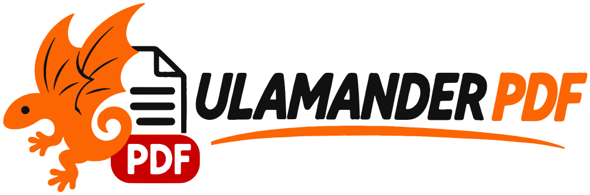
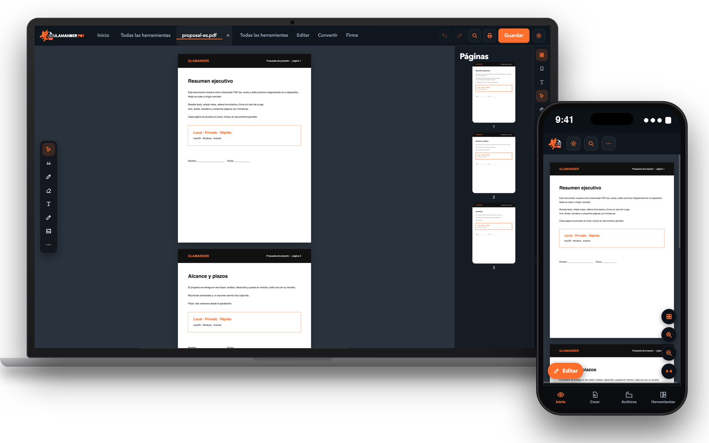

  <a href="https://pdf.ulamander.com"><picture>
    <source media="(prefers-color-scheme: dark)" srcset="assets/logo-horizontal-dark.png" />
    
  </picture></a>

  ### El editor de PDF privado para macOS, Windows y Android.
  Lee, anota, firma, organiza, protege, convierte y aplica OCR a tus PDF — **íntegramente en tu dispositivo.**
  Sin nube. Sin cuenta. Sin telemetría.

  [English](README.md) · **Español** · [Italiano](README.it.md) · [Français](README.fr.md)

## Por qué Ulamander PDF
La mayoría de herramientas PDF te piden subir contratos, facturas y documentos de identidad al servidor de otra empresa. Ulamander PDF hace lo contrario: **cada archivo se abre, edita y guarda en tu dispositivo** y la app funciona sin conexión.

## Qué incluye
- **Ver y navegar:** lectura continua, miniaturas, marcadores, búsqueda rápida y avanzada, varias pestañas, lectura en voz alta sin conexión.
- **Editar y anotar:** texto, imágenes, formas, resaltados y dibujo a mano sobre capas editables; marcas de agua, numeración, encabezados y pies.
- **Organizar:** reordenar, rotar, eliminar, unir, dividir, extraer, duplicar, invertir, recortar márgenes y comparar versiones.
- **Convertir y exportar:** imágenes ↔ PDF, texto, RTF, HTML, Markdown y **Word, Excel y PowerPoint**.
- **Firmar y proteger:** firma visual, **contraseña AES-256**, limpieza de metadatos, tachado y formularios.
- **OCR** sin conexión en español, italiano e inglés. **Imprimir** con el diálogo real del sistema.
- **Rueda de herramientas:** pulsa `Ctrl + Espacio` (en Mac `⌃ Espacio`) y se abre bajo el cursor.

## Descargas
| Plataforma | Archivo |
|---|---|
| macOS (Intel + Apple Silicon) | [`Ulamander-PDF-macOS-universal.dmg`](https://github.com/MiguelGranado/ulamander-pdf/releases/latest/download/Ulamander-PDF-macOS-universal.dmg) |
| Windows 10/11 x64 | [`Ulamander-PDF-X.Y.Z-x64.exe`](https://github.com/MiguelGranado/ulamander-pdf/releases/latest) |
| Android (APK) | [`Ulamander-PDF-X.Y.Z.apk`](https://github.com/MiguelGranado/ulamander-pdf/releases/latest) |

Este repositorio contiene **solo instaladores compilados**. En macOS, clic derecho → *Abrir* la primera vez; en Windows, *Más información → Ejecutar de todas formas* (el instalador aún no está firmado).

## Licencia de uso
Software **por invitación**: cada copia se activa con un código personal. **€20 al año** o **€50 de por vida**. Sin versión gratuita ni compra dentro de la app. → [Obtener mi código](https://pdf.ulamander.com/#pricing)

## Privacidad
Los documentos nunca se suben. Solo se contacta con nuestro servidor de licencias para validar el código y con GitHub para avisarte de nuevas versiones. Detalles en [SECURITY.md](SECURITY.md).

## Soporte
[info@ulamander.com](mailto:info@ulamander.com) · [pdf.ulamander.com](https://pdf.ulamander.com) · [ulamander.com](https://ulamander.com)

© Ulamander. Todos los derechos reservados. Producto independiente basado en el estándar abierto PDF (ISO 32000).

