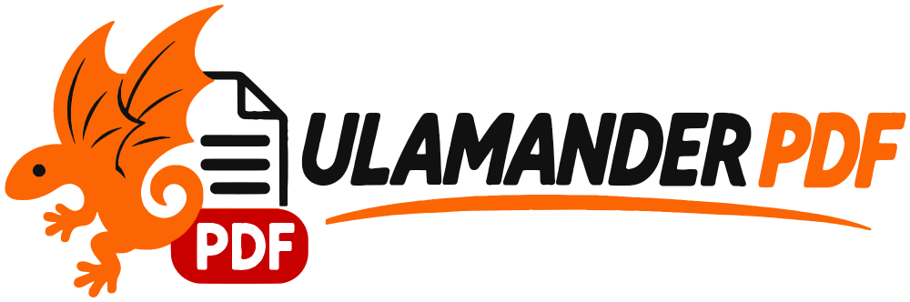
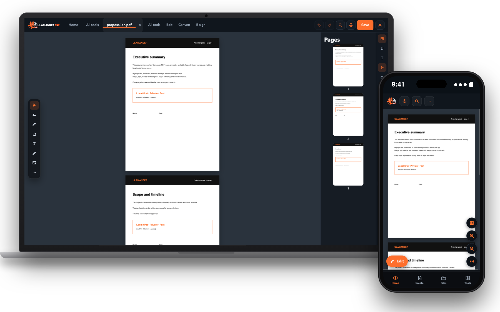

  <a href="https://pdf.ulamander.com"><picture>
    <source media="(prefers-color-scheme: dark)" srcset="assets/logo-horizontal-dark.png" />
    
  </picture></a>

  ### L’éditeur PDF privé pour macOS, Windows et Android.
  Lisez, annotez, signez, organisez, protégez, convertissez et passez en OCR vos PDF — **entièrement sur votre appareil.**
  Pas de cloud. Pas de compte. Pas de télémétrie.

  [English](README.md) · [Español](README.es.md) · [Italiano](README.it.md) · **Français**

## Pourquoi Ulamander PDF
La plupart des outils PDF vous demandent d’envoyer contrats, factures et pièces d’identité sur le serveur d’un tiers. Ulamander PDF fait l’inverse : **chaque fichier est ouvert, modifié et enregistré sur votre appareil**, et l’application fonctionne hors ligne.

## Fonctions
- **Lire et naviguer :** lecture continue, miniatures, signets, recherche rapide et avancée, onglets, lecture à voix haute hors ligne.
- **Modifier et annoter :** texte, images, formes, surlignages et dessin à main levée sur des calques modifiables ; filigranes, numérotation, en-têtes et pieds de page.
- **Organiser :** réordonner, pivoter, supprimer, fusionner, diviser, extraire, dupliquer, inverser, rogner les marges, comparer les versions.
- **Convertir et exporter :** images ↔ PDF, texte, RTF, HTML, Markdown et **Word, Excel, PowerPoint**.
- **Signer et protéger :** signature visuelle, **mot de passe AES-256**, nettoyage des métadonnées, caviardage et formulaires.
- **OCR** hors ligne (espagnol, italien, anglais). **Impression** avec la boîte de dialogue du système.
- **Roue d’outils :** `Ctrl + Espace` (sur Mac `⌃ Espace`) l’ouvre sous le curseur.

> L’interface est disponible en anglais, italien et espagnol.

## Téléchargements
| Plateforme | Fichier |
|---|---|
| macOS (Intel + Apple Silicon) | [`Ulamander-PDF-macOS-universal.dmg`](https://github.com/MiguelGranado/ulamander-pdf/releases/latest/download/Ulamander-PDF-macOS-universal.dmg) |
| Windows 10/11 x64 | [`Ulamander-PDF-X.Y.Z-x64.exe`](https://github.com/MiguelGranado/ulamander-pdf/releases/latest) |
| Android (APK) | [`Ulamander-PDF-X.Y.Z.apk`](https://github.com/MiguelGranado/ulamander-pdf/releases/latest) |

Ce dépôt ne contient que des **installateurs compilés**. Sur macOS : clic droit → *Ouvrir* au premier lancement ; sur Windows : *Informations complémentaires → Exécuter quand même* (l’installateur n’est pas encore signé).

## Licence d’utilisation
Logiciel **sur invitation** : chaque copie s’active avec un code personnel. **20 € par an** ou **50 € en une fois**. Pas de version gratuite ni d’achat intégré. → [Obtenir mon code](https://pdf.ulamander.com/#pricing)

## Confidentialité
Les documents ne sont jamais envoyés. Seuls notre serveur de licences (validation du code) et GitHub (information sur les nouvelles versions) sont contactés. Détails dans [SECURITY.md](SECURITY.md).

## Assistance
[info@ulamander.com](mailto:info@ulamander.com) · [pdf.ulamander.com](https://pdf.ulamander.com) · [ulamander.com](https://ulamander.com)

© Ulamander. Tous droits réservés. Produit indépendant fondé sur le standard ouvert PDF (ISO 32000).

