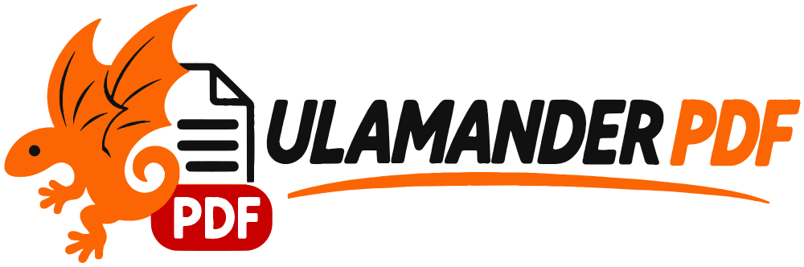
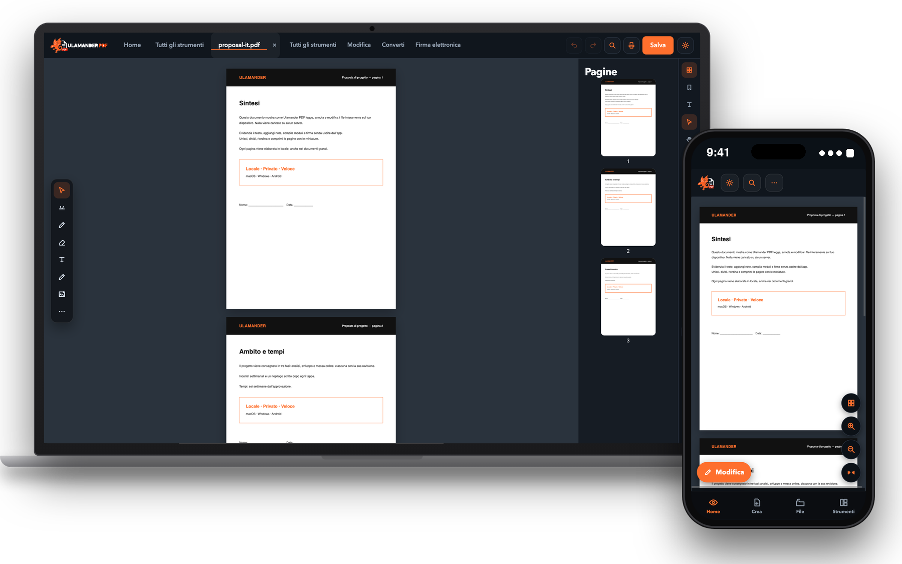

  <a href="https://pdf.ulamander.com"><picture>
    <source media="(prefers-color-scheme: dark)" srcset="assets/logo-horizontal-dark.png" />
    
  </picture></a>

  ### L’editor PDF privato per macOS, Windows e Android.
  Leggi, annota, firma, organizza, proteggi, converti e applica l’OCR ai tuoi PDF — **interamente sul tuo dispositivo.**
  Nessun cloud. Nessun account. Nessuna telemetria.

  [English](README.md) · [Español](README.es.md) · **Italiano** · [Français](README.fr.md)

## Perché Ulamander PDF
Quasi tutti gli strumenti PDF ti chiedono di caricare contratti, fatture e documenti d’identità sul server di qualcun altro. Ulamander PDF fa il contrario: **ogni file viene aperto, modificato e salvato sul tuo dispositivo** e l’app funziona anche offline.

## Funzioni
- **Visualizza e naviga:** lettura continua, miniature, segnalibri, ricerca veloce e avanzata, più schede, lettura ad alta voce offline.
- **Modifica e annota:** testo, immagini, forme, evidenziazioni e disegno a mano su livelli modificabili; filigrane, numeri di pagina, intestazioni e piè di pagina.
- **Organizza:** riordina, ruota, elimina, unisci, dividi, estrai, duplica, inverti, ritaglia i margini e confronta le versioni.
- **Converti ed esporta:** immagini ↔ PDF, testo, RTF, HTML, Markdown e **Word, Excel e PowerPoint**.
- **Firma e proteggi:** firma visiva, **password AES-256**, pulizia dei metadati, oscuramento e moduli.
- **OCR** offline in italiano, spagnolo e inglese. **Stampa** con la finestra di sistema.
- **Ruota degli strumenti:** premi `Ctrl + Spazio` (su Mac `⌃ Spazio`) e si apre sotto il cursore.

## Download
| Piattaforma | File |
|---|---|
| macOS (Intel + Apple Silicon) | [`Ulamander-PDF-macOS-universal.dmg`](https://github.com/MiguelGranado/ulamander-pdf/releases/latest/download/Ulamander-PDF-macOS-universal.dmg) |
| Windows 10/11 x64 | [`Ulamander-PDF-X.Y.Z-x64.exe`](https://github.com/MiguelGranado/ulamander-pdf/releases/latest) |
| Android (APK) | [`Ulamander-PDF-X.Y.Z.apk`](https://github.com/MiguelGranado/ulamander-pdf/releases/latest) |

Questo repository contiene **solo installer compilati**. Su macOS: clic destro → *Apri* al primo avvio; su Windows: *Maggiori informazioni → Esegui comunque* (l’installer non è ancora firmato).

## Licenza d’uso
Software **su invito**: ogni copia si attiva con un codice personale. **€20 all’anno** oppure **€50 una tantum**. Nessuna versione gratuita né acquisto in-app. → [Richiedi il tuo codice](https://pdf.ulamander.com/#pricing)

## Privacy
I documenti non vengono mai caricati. Si contatta solo il nostro server delle licenze per validare il codice e GitHub per avvisarti delle nuove versioni. Dettagli in [SECURITY.md](SECURITY.md).

## Assistenza
[info@ulamander.com](mailto:info@ulamander.com) · [pdf.ulamander.com](https://pdf.ulamander.com) · [ulamander.com](https://ulamander.com)

© Ulamander. Tutti i diritti riservati. Prodotto indipendente basato sullo standard aperto PDF (ISO 32000).

