

  

  # Ulamander PDF

  ### The private PDF editor for macOS, Windows and Android.
  Read, annotate, sign, organize, protect and convert PDFs — **entirely on your own device.**
  No cloud. No account. No telemetry.

  
  
  
  
  

  **[Download](#downloads)** · **[Features](#features)** · **[The tool wheel](#the-tool-wheel)** · **[Shortcuts](#keyboard-shortcuts)** · **[Pricing](#get-a-license)** · **[FAQ](#faq)**

 

  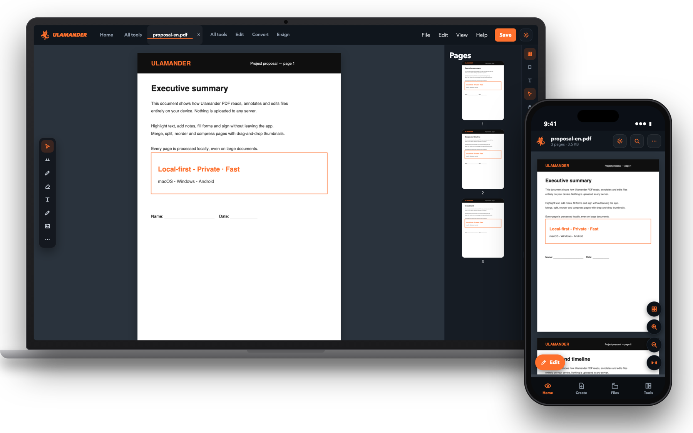

---

## Why Ulamander PDF

Most PDF tools ask you to upload your contracts, invoices and IDs to somebody else's server. Ulamander PDF does the
opposite: **every file is opened, edited and saved on your device**, and the app works fully offline.

| | |
|---|---|
| 🔒 **Private by design** | Documents are never uploaded. No account, no analytics, no third‑party trackers. |
| 🧰 **Everything in one app** | Edit, annotate, sign, fill forms, OCR, merge, split, compress, protect and convert. |
| 🖥️ **One app, three platforms** | macOS, Windows and Android with native menus and shortcuts on each. |
| ⚡ **Fast on big files** | Smooth rendering and page thumbnails, even on long documents. |
| 🌍 **Three languages** | English, Italian and Spanish — switch any time, no restart. |
| 🎨 **Comfortable to look at** | Dark and light themes, adjustable contrast and text size. |

---

## A quick tour

### A clean home, with your recent files and quick tools

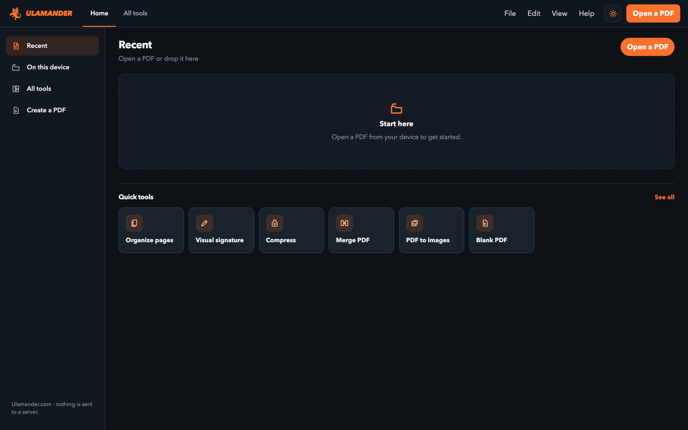

### A real reader and editor
Continuous reading, page thumbnails, zoom modes, search, bookmarks and a floating tool rail for annotations —
all on editable layers, so nothing is baked into the page until you save.

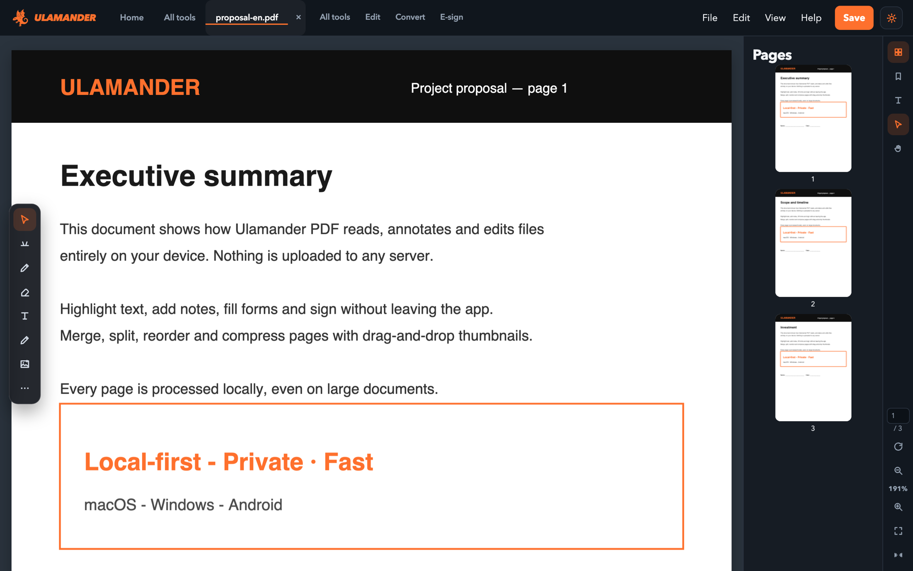

### Every tool one click away

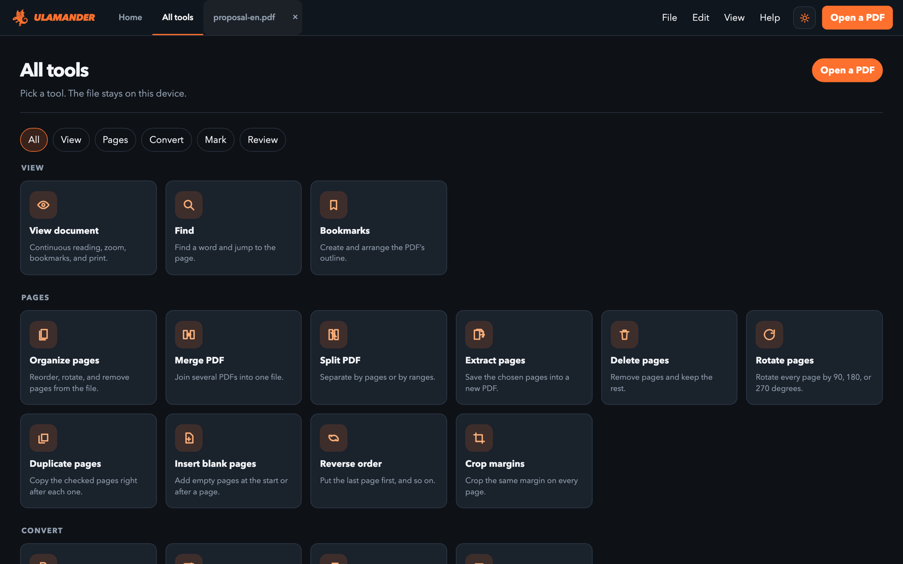

### Organize pages by drag and drop
Reorder, rotate and delete pages visually. Nothing changes in the file until you press **Apply**.

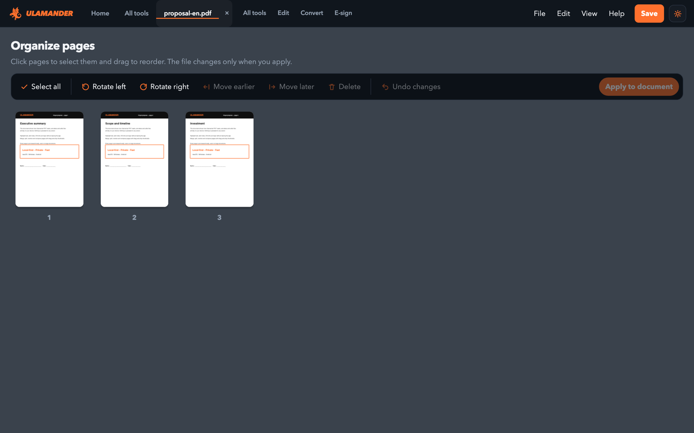

<table>
  <tr>
    <td width="50%">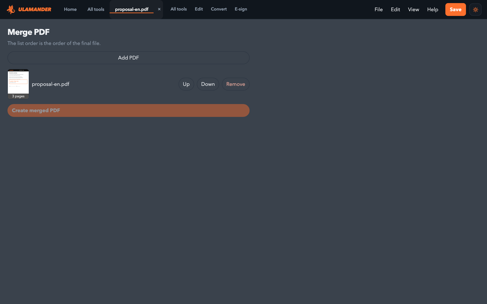 <b>Merge</b> several PDFs into one.</td>
    <td width="50%">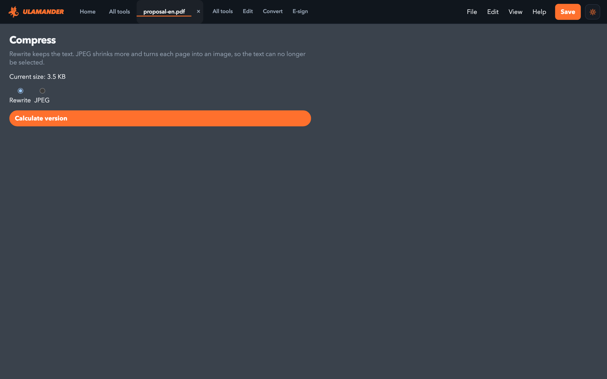 <b>Compress</b> heavy files without leaving the app.</td>
  </tr>
  <tr>
    <td width="50%">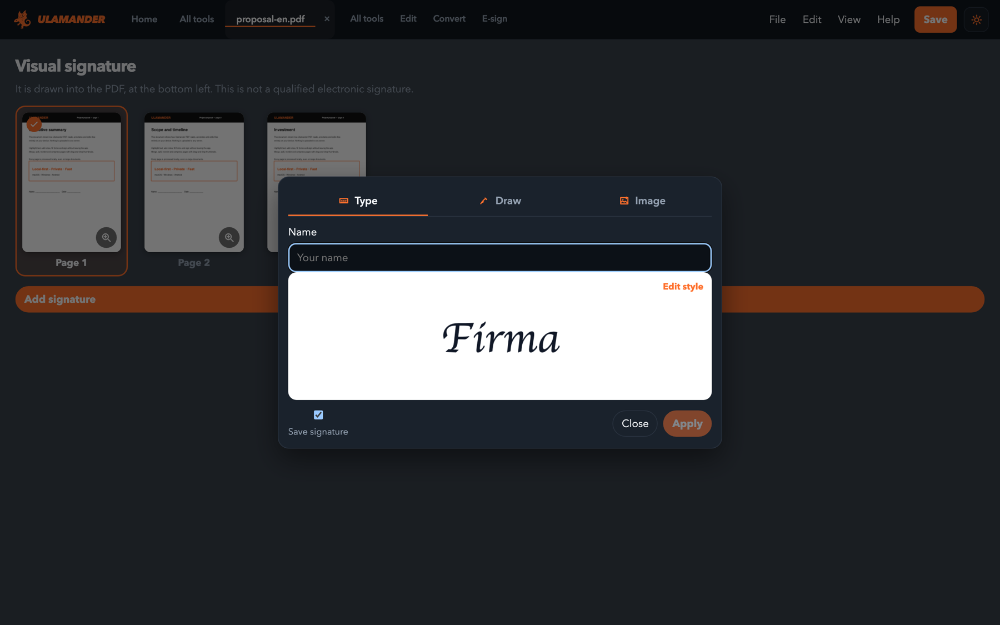 <b>Sign</b> with a visual signature.</td>
    <td width="50%">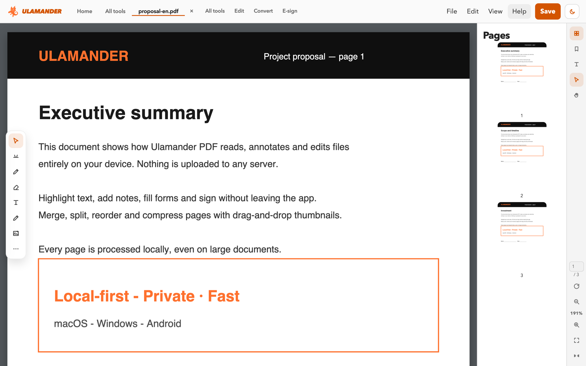 <b>Light theme</b> for bright rooms.</td>
  </tr>
</table>

---

## The tool wheel

Press **`Ctrl` + `Space`** anywhere in the app and the **tool wheel** opens right under your cursor: Find, Organize
pages, Merge, Sign, Compress, PDF to images, Blank PDF and View — one click away, no menus.
Press `Esc` (or the ✕) to close it.

  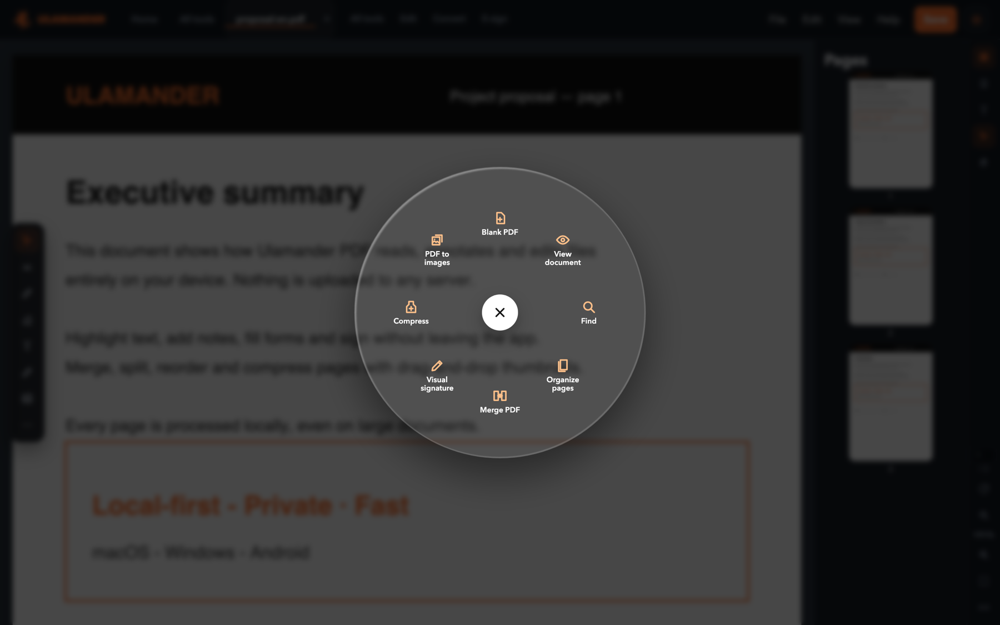
  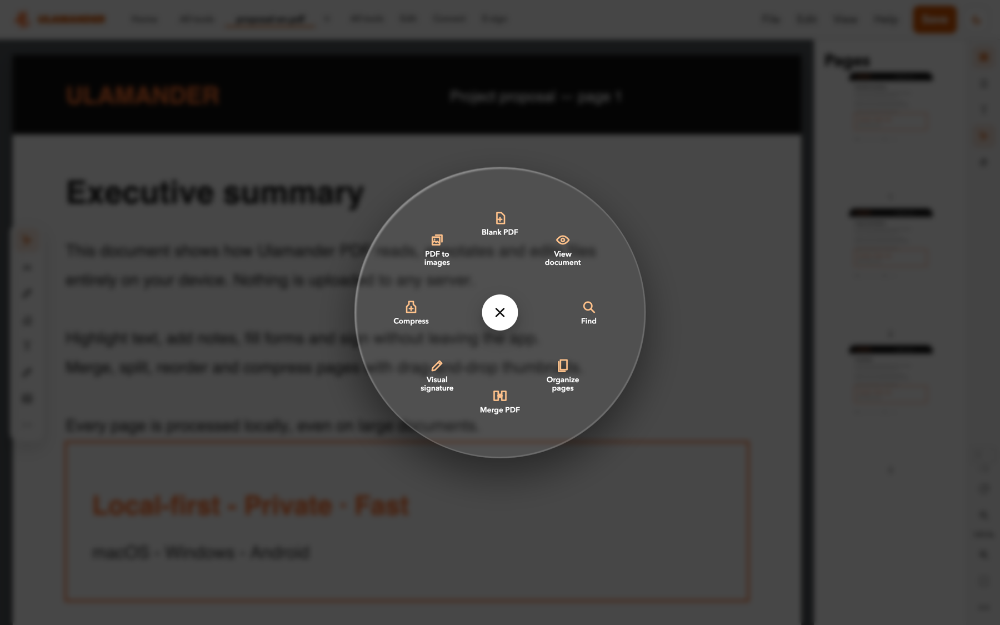

> **On macOS** `⌘ Space` is reserved by Spotlight, so use **`⌃ Space`** (or `⌥ Space`). On Windows use `Ctrl + Space`
> or `Alt + Space`.

---

## Features

### 📖 View & navigate
- Continuous reading, page thumbnails, bookmarks and an outline
- Fit page, fit width, actual size and fit visible; zoom tool and hand tool
- Fast search with next/previous and an advanced search panel
- Several documents open at once in tabs; reopen your recent files
- Reader mode and full screen
- Read aloud with the system's own voices (offline)

### ✍️ Edit & annotate
- Text, images, shapes, highlights and freehand drawing on real **editable layers**
- Select, move, resize and nudge objects; undo and redo everywhere
- Watermarks, page numbers, headers and footers, image stamps
- Overlay one PDF on top of another

### 🗂️ Organize
| Tool | What it does |
|---|---|
| **Organize pages** | Reorder, rotate and remove pages with thumbnails |
| **Merge PDF** | Join several files into one |
| **Split PDF** | Separate by pages or by ranges |
| **Extract / Remove pages** | Pull selected pages into a new PDF, or delete them |
| **Rotate / Duplicate / Reverse** | Rotate 90/180/270°, duplicate pages, invert the order |
| **Insert blank pages** | At the start or after any page |
| **Crop margins** | Apply the same crop to every page |
| **Compare** | Find the differences between two versions |

### 🔁 Convert & export
- Images → PDF and PDF → images (PNG, JPG, WebP)
- PDF → plain text, RTF, HTML and Markdown
- Export to **Word, Excel and PowerPoint**
- Create a new blank PDF

### 🔐 Sign & protect
- Visual signatures and image stamps
- **Password protection (AES‑256)**, document metadata cleaning and redaction
- Fill existing **forms**, or create new form fields

### 🔎 OCR
Turn scanned pages into searchable, selectable text — in Spanish, Italian and English, fully on your device.

### 🖨️ Print
The real system print dialog: page range, copies, quality and duplex.

### ♿ Accessible
Color, contrast and text‑size options; full keyboard navigation; command palette (`⇧⌘P` / `Ctrl+Shift+P`).

---

## Keyboard shortcuts

| Action | macOS | Windows |
|---|---|---|
| **Tool wheel** | `⌃ Space` | `Ctrl + Space` |
| Open file | `⌘ O` | `Ctrl + O` |
| Save | `⌘ S` | `Ctrl + S` |
| Print | `⌘ P` | `Ctrl + P` |
| Find / next | `⌘ F` / `⌘ G` | `Ctrl + F` / `Ctrl + G` |
| Command palette | `⇧ ⌘ P` | `Ctrl + Shift + P` |
| Zoom in / out | `⌘ +` / `⌘ −` | `Ctrl + +` / `Ctrl + −` |
| Fit page / actual size | `⌘ 0` / `⌘ 1` | `Ctrl + 0` / `Ctrl + 1` |
| Full screen | `⌘ L` | `Ctrl + L` |
| Document properties | `⌘ D` | `Ctrl + D` |
| Close document | `⌘ W` | `Ctrl + W` |
| Settings | `⌘ ,` | — |
| Help guide | `F1` | `F1` |

---

## Downloads

This repository ships **compiled installers only**. Grab the latest build from
[**Releases**](../../releases/latest):

| Platform | File | Notes |
|---|---|---|
| 🍎 **macOS** (Apple Silicon) | [`Ulamander-PDF-macOS-arm64.dmg`](../../releases/latest/download/Ulamander-PDF-macOS-arm64.dmg) | Unsigned build — see install notes |
| 🪟 **Windows** (x64) | [`Ulamander-PDF-Setup-win-x64.exe`](../../releases/latest/download/Ulamander-PDF-Setup-win-x64.exe) | Unsigned build — see install notes |
| 🤖 **Android** | [`Ulamander-PDF-android.apk`](../../releases/latest/download/Ulamander-PDF-android.apk) | Allow installs from this source |

### Install notes
- **macOS** — the app isn't notarized yet, so Gatekeeper warns on first launch. Right‑click the app → **Open**
  (or *System Settings → Privacy & Security → Open Anyway*).
- **Windows** — SmartScreen may warn about an unrecognized publisher. Click **More info → Run anyway**.
- **Android** — you'll be asked to allow installs from this source the first time.

---

## Get a license

Ulamander PDF is **invitation‑only software**: the download is complete, and every copy unlocks with a personal,
one‑time activation key tied to your device. There is no free tier and no in‑app purchase.

| Plan | Price | Best for |
|---|---|---|
| **Annual** | **€20 / year** | Trying it on your own documents |
| **Lifetime** | **€50 once** | Everyday use, forever |

<a href="https://pdf.ulamander.com/#pricing"><b>🔑 Get your activation key →</b></a>

**How activation works:** the app sends your key and a random device identifier to our own activation server —
**never your documents**. A key works on one device at a time, and you can ask to move it to a new one. After
activation the app works offline.

---

## Languages
English · Italiano · Español — the interface follows your system language and you can change it at any time.

---

## Privacy
- Documents are opened, edited and saved **locally**. Nothing is uploaded.
- OCR and read‑aloud run on your device, fully offline.
- No accounts, no analytics, no third‑party trackers.
- The only network call is the one‑time license check described above.

---

## FAQ

<b>What is Ulamander PDF?</b>

A private PDF reader and editor for macOS, Windows and Android that works offline.

<b>Does it upload my PDFs to a server?</b>

No. Documents are opened, edited and saved locally.

<b>Which platforms are supported?</b>

macOS (Apple Silicon), Windows x64 and Android.

<b>How much does it cost?</b>

€20 per year or €50 once (lifetime). Each copy needs a personal activation key.

<b>Can I use one key on two computers?</b>

A key is tied to one device at a time. Write to us and we'll move it to a new one.

<b>The wheel doesn't open on my Mac.</b>

Use <code>⌃ Space</code> (Control + Space) or <code>⌥ Space</code>. <code>⌘ Space</code> belongs to Spotlight. If Control + Space
is assigned to switching input sources, change it in System Settings → Keyboard → Keyboard Shortcuts → Input Sources.

---

## Support
Questions, bugs or license issues → **[info@ulamander.com](mailto:info@ulamander.com)** · More at **[pdf.ulamander.com](https://pdf.ulamander.com)**

© Ulamander — <a href="https://ulamander.com">ulamander.com</a>. All rights reserved.
Independent product built on the open PDF standard (ISO 32000).

