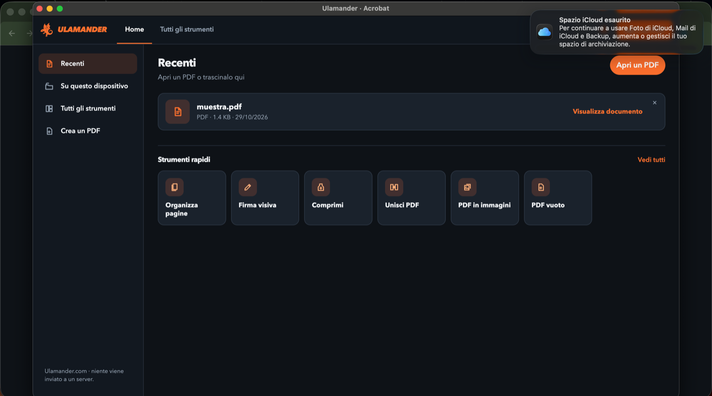
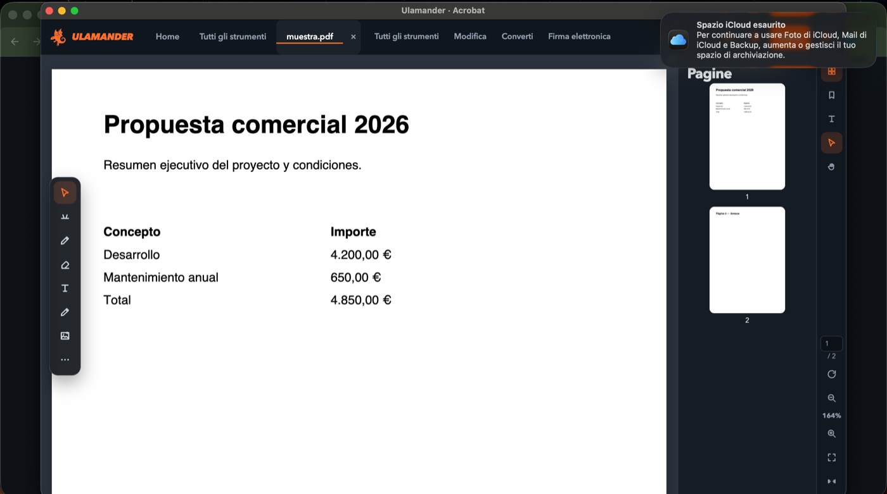
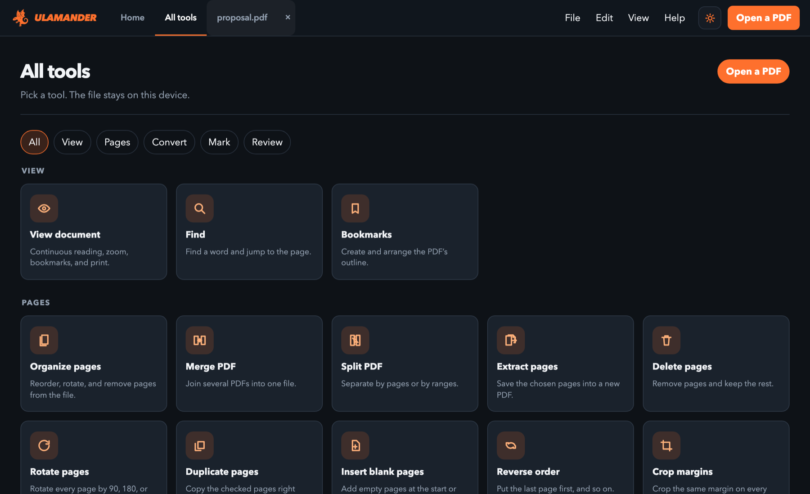
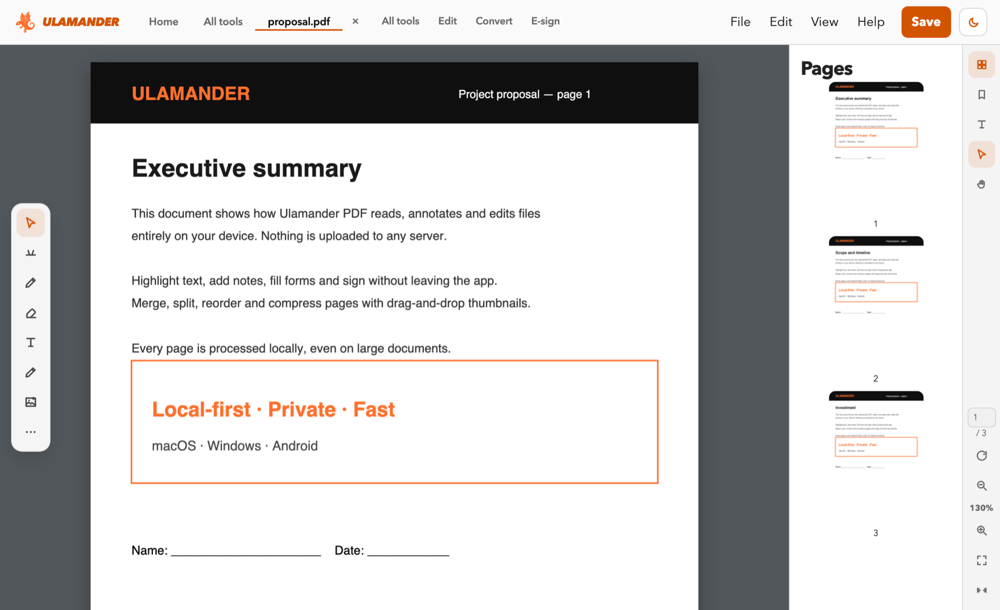

  

  # Ulamander PDF

  **A local‑first PDF reader and editor for macOS, Windows and Android.**
  Your documents never leave your device — no cloud, no account, no telemetry.

  
  

---

## Why Ulamander PDF

- **Private by design** — files are processed on your device; nothing is uploaded, ever.
- **Complete** — edit, annotate, sign, fill forms, OCR, merge, split, compress, protect and convert.
- **Everywhere** — one app for macOS, Windows and Android, in Italian, English and Spanish.
- **Fast** — native rendering, smooth on large documents.

More information: **[pdf.ulamander.com](https://pdf.ulamander.com)** · Part of the [Ulamander](https://ulamander.com) ecosystem.

## What it is

Open, read, edit, sign, organize, protect and export PDF files — entirely on your own machine. Built for
people who want a complete PDF workflow without sending their documents to anyone's server.

| | |
|---|---|
| 🖊️ **Edit** | Text, images, shapes, highlights, drawing — on real editable layers |
| 🔐 **Sign & protect** | Visual signatures, password protection (AES‑256), metadata removal, redaction |
| 🗂️ **Organize** | Merge, split, extract, reorder, rotate, insert/remove pages, bookmarks |
| 🔎 **OCR** | Make scanned pages searchable and selectable (Spanish, Italian, English) |
| 📤 **Export** | Word, Excel, PowerPoint, images (PNG/JPG/WebP), TXT, RTF, HTML, Markdown |
| 🖨️ **Print** | Real system print dialog — page range, copies, quality, duplex |
| 📝 **Forms** | Fill existing form fields, or create new ones |
| 🌍 **Languages** | Spanish, Italian, English — switch anytime, no restart |
| 📴 **Offline‑first** | No account, no cloud sync, no analytics. Everything stays on your device |

Native menus and shortcuts on each platform (macOS menu bar, Windows menu bar, a bottom‑sheet menu on
Android), a command palette, accessible color/contrast/text‑size options, and read‑aloud via the system's
own voices.

## Screenshots

  
  

  
  

## Downloads

This repository ships **compiled installers only** — no source code. Grab the latest build from
[**Releases**](../../releases/latest):

| Platform | File | Notes |
|---|---|---|
| 🍎 macOS (Apple Silicon) | [`Ulamander-PDF.dmg`](../../releases/latest/download/Ulamander-PDF-macOS-arm64.dmg) | Unsigned build — see *Install notes* below |
| 🪟 Windows (x64) | [`Ulamander-PDF-Setup.exe`](../../releases/latest/download/Ulamander-PDF-Setup-win-x64.exe) | Unsigned build — see *Install notes* below |
| 🤖 Android | [`Ulamander-PDF.apk`](../../releases/latest/download/Ulamander-PDF-android.apk) | Enable "install from unknown sources" |

### Install notes

- **macOS:** since the app isn't notarized yet, Gatekeeper will warn you. Right‑click the app → **Open** the
  first time (or: System Settings → Privacy & Security → **Open Anyway**).
- **Windows:** SmartScreen may warn about an unrecognized publisher (unsigned build). Click **More info →
  Run anyway**.
- **Android:** you'll be asked to allow installs from this source the first time.

## Get a license

Ulamander PDF is **invitation‑only software**: it's fully functional in the download, but every copy
needs a personal, one‑time activation key tied to your device before it unlocks. There's no free tier and
no in‑app purchase.

| Plan | Price |
|---|---|
| Annual | **€20 / year** |
| Lifetime | **€50 once** |

**[🔑 Get a license →](https://pdf.ulamander.com/#pricing)**

What happens with your activation: the app sends your key and a random device identifier to our own
activation server — **never your documents**. A key only works on one device at a time; you can always ask
to move it to a new one.

## Privacy

- Documents are opened, edited and saved **locally**. Nothing is uploaded.
- OCR and read‑aloud run on your device, fully offline.
- No accounts, no analytics, no third‑party trackers.
- The only network call is the one‑time license check described above.

## Support

Questions, bugs or license issues → **[info@ulamander.com](mailto:info@ulamander.com)**

---

© Ulamander — <a href="https://ulamander.com">ulamander.com</a>. All rights reserved.
Independent product built on the open PDF standard (ISO 32000).

## FAQ

**What is Ulamander PDF?** A private PDF reader and editor for macOS, Windows and Android that works offline.

**Does it upload my PDFs to a server?** No. Documents are opened, edited and saved locally.

**Which platforms are supported?** macOS (Apple Silicon), Windows x64 and Android.

**How much does it cost?** €20 per year or €50 once (lifetime). Each copy needs a personal activation key.
